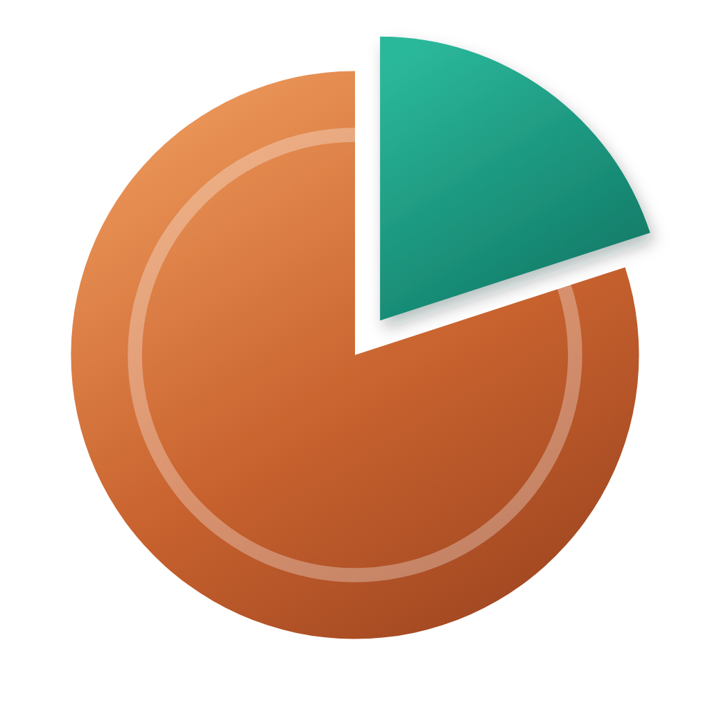

<p align="center"></p>

<h1 align="center">Penny</h1>
<p align="center"><b>Every cent, in focus.</b> Private personal finance for Windows — encrypted, offline, in your language.</p>

---

## Why Penny
- **Private by design.** Everything stays on your PC. No account, no cloud, no ads, no analytics, never asks for bank passwords.
- **Encrypted.** Your data and every backup are encrypted with AES-256, locked to your Windows account; add a passcode for a second lock with a recovery key. See [docs/SECURITY.md](docs/SECURITY.md).
- **Fast to use.** Type "coffee 4.50 yesterday" and Penny fills in the rest. Ask "how much did I spend on food last month?" with Ctrl K.
- **Honest guidance.** A Financial Health Report built on published research (World Bank, OECD, Vanguard, Morningstar and more), with country-specific rules marked, a debt payoff planner, and a one-click PDF.
- **For everyone.** Fully translated into English, Chinese (Simplified), Hindi, Spanish and Arabic (right-to-left), including the installer, the legal texts and natural-language entry; any currency, local number and date formats, keyboard and screen-reader friendly. New users get a guided tour.

## Features
Overview dashboard · transactions with natural-language entry · receipts and files on transactions (encrypted) · right-click menus · bank statement import (CSV, OFX) with duplicate detection · accounts, credit cards and loans · budgets with auto-suggest · safe-to-spend today · goals · bills and subscriptions · reminders with Windows notifications · calendar · insights · Financial Health Report · planner · rules · multi-currency · privacy blur (P) · passcode lock and encryption · automatic, validated backups · encrypted export · signed in-app updates from GitHub Releases.

## Community
Questions, ideas and early news: [join the Penny Discord](https://discord.gg/r5kNGC6p29).

## Install
Download the latest installer from [Releases](https://github.com/abdallhhelles/penny/releases). Penny then keeps itself up to date: it checks GitHub, verifies each update's signature, and asks you to restart.

## Build from source
```bash
npm ci
npm start                 # run
npm test                  # unit tests
npm run test:e2e          # end-to-end (needs Python 3 + Playwright and a display / Xvfb)
npm run i18n:check        # translation coverage
node tools/release-check.js
bash installer/build_exe.sh   # Windows installer (see the script header)
```

## Releasing an update
Tag a version and push it; the GitHub workflow tests, signs and publishes it. Full steps: [docs/GITHUB-UPDATES.md](docs/GITHUB-UPDATES.md).

## Translate Penny
Language files live in `renderer/locales/<code>.json`. Copy `en.json`, translate the values (keep `{placeholders}`), and run `npm run i18n:check`. Details: [docs/I18N.md](docs/I18N.md).

## Project layout
| Path | What it is |
|---|---|
| `bootstrap.js`, `main.js`, `preload.js` | Electron shell, window, IPC |
| `store.js` | data store (atomic saves, backups, recovery) and the encryption vault |
| `updater.js` | signed update checks and downloads |
| `renderer/` | the app UI (plain JS, no framework) and `locales/` |
| `tests/` | unit (`*.test.js`) and end-to-end (`e2e_*.py`) tests |
| `tools/` | release, signing and translation tools |
| `installer/` | NSIS installer |

## License
© 2026 Akrot. All rights reserved. The source is published for transparency; see `installer/LICENSE.txt` for the end-user license.
